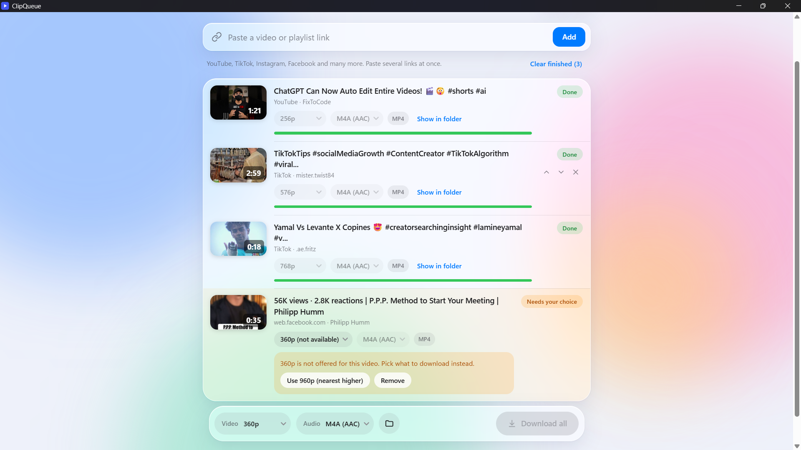
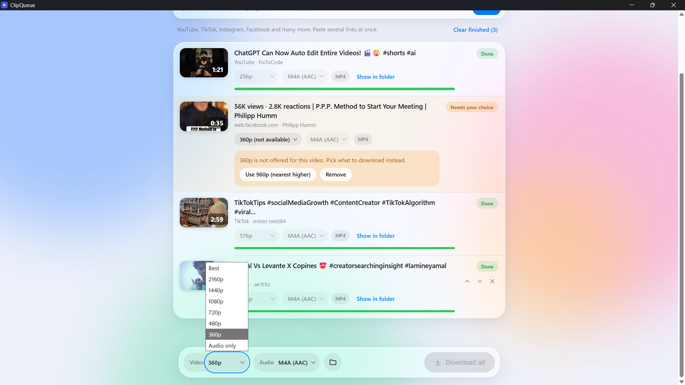
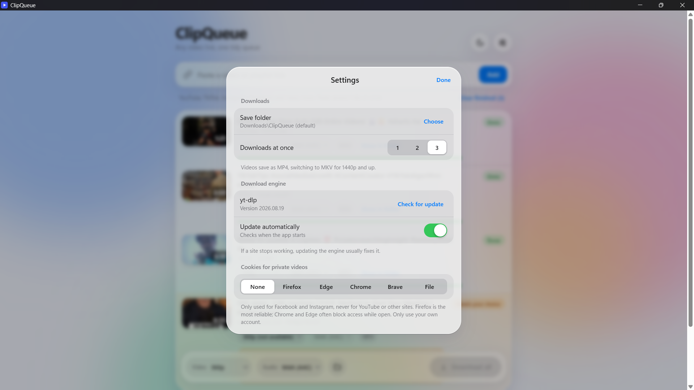
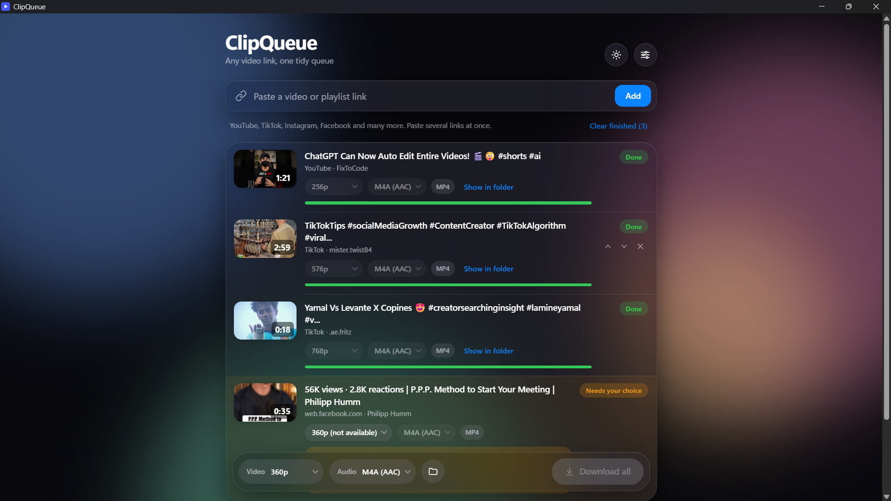

<h1 align="center">ClipQueue</h1>

<p align="center">
A lightweight Windows app that queues video links and downloads them one after another,<br>
with an iOS-inspired glass interface.<br>
YouTube · TikTok · Instagram · Facebook · and many other video sites
</p>

<p align="center">
  
  
  
  
</p>

<p align="center"></p>

## Features

- **Queue many links.** Paste several at once. Playlists, channels, profiles and multi-video posts expand into separate items (up to 100).
- **Choose quality first.** Pick video resolution and audio format (MP3, M4A, Opus, WAV), as a default or per video.
- **Skip and ask.** If the chosen quality is not available, the item is flagged with one-tap "nearest lower / nearest higher" buttons. Nothing downloads at the wrong quality by surprise.
- **Smart container.** MP4 by default, switching to MKV for 1440p and up.
- **Fast and visible.** 1 to 3 parallel downloads, live progress, speed and time left, cancel, reorder, and a queue that survives restarts.
- **Private videos (optional).** Use cookies from your own browser or a `cookies.txt` file for Facebook and Instagram. Cookies are never sent for YouTube or other sites.
- **Stays working.** One-click or automatic yt-dlp updates from Settings.
- **Light and dark** glass themes.

| Quality fallback | Settings | Dark theme |
|---|---|---|
|  |  |  |

## Download

Get the latest build from **[Releases](https://github.com/sajith-ali/clipqueue/releases/latest)**:

| File | What it is |
|---|---|
| `ClipQueue_x.y.z_x64-setup.exe` | Installer (recommended). Installs for your user only, no admin rights needed. |
| `ClipQueue-portable.zip` | Portable. Unzip anywhere and run `clipqueue.exe`. |

**Requirements:** Windows 10 or 11 (64-bit). The WebView2 runtime comes with Windows 11; the installer sets it up on Windows 10. For the portable version on Windows 10, install it from the [WebView2 page](https://developer.microsoft.com/microsoft-edge/webview2/) if the app does not open. yt-dlp and FFmpeg are bundled, so there is nothing else to install.

> **Windows SmartScreen** may warn that the app is from an unknown publisher because it is not code-signed. Choose **More info**, then **Run anyway**.

## How to use

1. Copy a video link, then press **Ctrl+V** anywhere in the window (or paste into the link bar and press **Add**).
2. Optionally set **Video** and **Audio** defaults in the bottom bar, or change them on any item.
3. Items marked **Needs your choice** have no download at the quality you picked. Tap a suggested quality, or remove the item.
4. Press **Download all**. Files are saved to `Downloads\ClipQueue` unless you change it in **Settings**.

## Build from source

### Prerequisites

| Tool | Why | Install (PowerShell) |
|---|---|---|
| Git | Clone the repo | `winget install Git.Git` |
| Node.js 20+ | Builds the interface | `winget install OpenJS.NodeJS.LTS` |
| Rust (MSVC toolchain) | Builds the app core | `winget install Rustlang.Rustup` |
| Visual Studio Build Tools, **Desktop development with C++** | Rust linker on Windows | `winget install Microsoft.VisualStudio.2022.BuildTools --override "--wait --passive --add Microsoft.VisualStudio.Workload.VCTools --includeRecommended"` |
| WebView2 runtime | Shows the interface | Already on Windows 11 |

Close and reopen PowerShell after installing so the new tools are found.

### Steps

```powershell
git clone https://github.com/sajith-ali/clipqueue.git C:\clipqueue
cd C:\clipqueue
powershell -ExecutionPolicy Bypass -File .\check-setup.ps1     # lists anything missing
powershell -ExecutionPolicy Bypass -File .\get-engines.ps1     # downloads yt-dlp, ffmpeg, ffprobe
npm install
npm run tauri dev                                               # run in development (first build takes several minutes)
```

Build the installer: `npm run tauri build`. It appears in `src-tauri\target\release\bundle\nsis\`.
Make the portable zip afterwards: `powershell -ExecutionPolicy Bypass -File .\make-portable.ps1`.

### Check what is missing

`check-setup.ps1` changes nothing. It reports each item as OK, MISSING (with the fix) or WARN:

- Node.js 20+, npm, Rust, the MSVC toolchain, C++ Build Tools, WebView2
- `node_modules`, the three engine files in `src-tauri\binaries`, the app icon
- Port 1420 free, project not in a synced or very long folder, antivirus exclusion, enough disk space

## Troubleshooting

| Problem | Fix |
|---|---|
| `os error 32` / "file is being used by another process" during build | Antivirus is scanning build files. Rerun the command (each try gets further), build with `cargo build -j 1` inside `src-tauri`, and exclude the project folder and `%USERPROFILE%\.cargo` from real-time scanning (`Add-MpPreference -ExclusionPath` in admin PowerShell). Keep the project out of Downloads, Desktop and OneDrive. |
| `resource path binaries\yt-dlp-...exe doesn't exist` | Run `get-engines.ps1`. |
| Vite `EBUSY ... watch` crash | Make sure `vite.config.ts` ignores `**/src-tauri/**` (already set in this repo). |
| `Port 1420 is already in use` | Another dev server is running: `taskkill /F /IM node.exe`. |
| Script is blocked | Run scripts with `powershell -ExecutionPolicy Bypass -File .\script.ps1`. |
| "Link failed" / "not supported" | Use the direct page of a single video. Then try **Settings → Check for update**. |
| YouTube asks for a sign-in check | Update the engine in Settings and retry later. |
| Facebook or Instagram video is private | Choose a cookies source in Settings. Firefox is the most reliable; Chrome, Edge and Brave often block access while open. A `cookies.txt` file works with any browser. |
| "ffmpeg is missing" | Run `get-engines.ps1` and rebuild. |
| App will not open on Windows 10 (portable) | Install the WebView2 runtime. |
| `Update failed` | Check your connection. The updater cannot run during a download. |

## Project structure

```
src/                 React + TypeScript interface (App.tsx, styles.css)
src-tauri/src/       Rust core: runs yt-dlp/ffmpeg, queue events, updater
src-tauri/binaries/  yt-dlp, ffmpeg, ffprobe (downloaded, not in Git)
get-engines.ps1      Downloads the bundled engines
check-setup.ps1      Checks prerequisites and project files
make-portable.ps1    Builds the portable zip
```

Built with [Tauri v2](https://tauri.app), React, TypeScript and Vite.

<!--

## Publishing a release (maintainers)

1. Update the version in `src-tauri/tauri.conf.json` and `package.json`, then run `npm run tauri build` and `make-portable.ps1`.
2. On GitHub: **Releases → Draft a new release**, create a tag such as `v0.1.0`, and upload the installer `.exe` and `ClipQueue-portable.zip`.
3. Suggested repository **topics** (Settings gear next to About): `tauri`, `rust`, `react`, `typescript`, `yt-dlp`, `ffmpeg`, `video-downloader`, `youtube-downloader`, `tiktok-downloader`, `instagram-downloader`, `windows`, `desktop-app`, `glassmorphism`.

-->

## Legal

ClipQueue is for downloading content you have the right to save, such as your own videos or content that allows downloads. Downloading may violate a site's terms of service or copyright law in your country; you are responsible for how you use it. Only use cookies from your own accounts. This project is not affiliated with YouTube, TikTok, Instagram, Facebook or Meta.

**Third-party software:** [yt-dlp](https://github.com/yt-dlp/yt-dlp) does the downloading and [FFmpeg](https://ffmpeg.org) merges and converts media. Both keep their own licenses. The FFmpeg build fetched by `get-engines.ps1` may be GPL-licensed, so if you publish builds that include it, follow its license terms (for example, link to its source).
